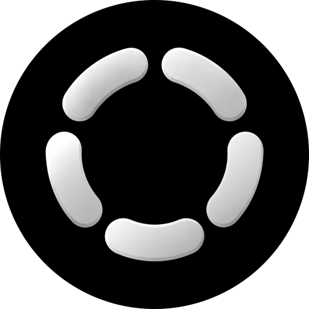
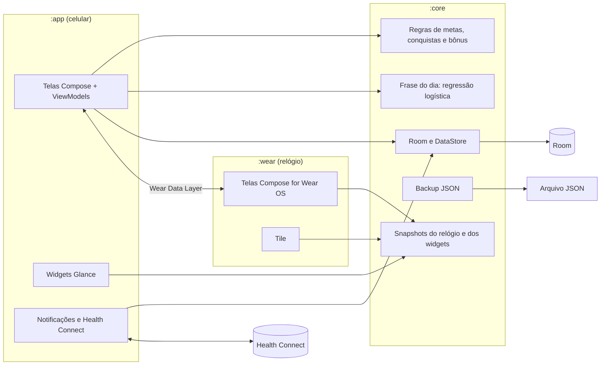
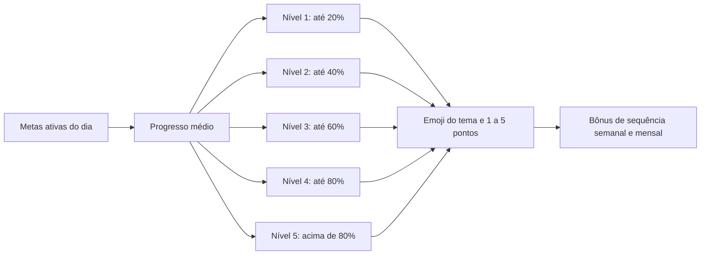
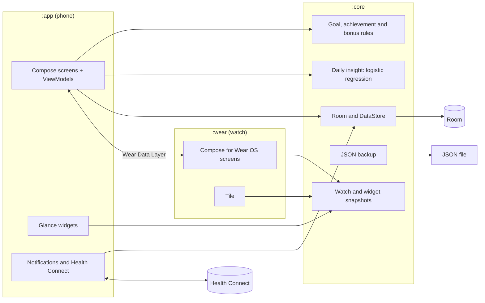
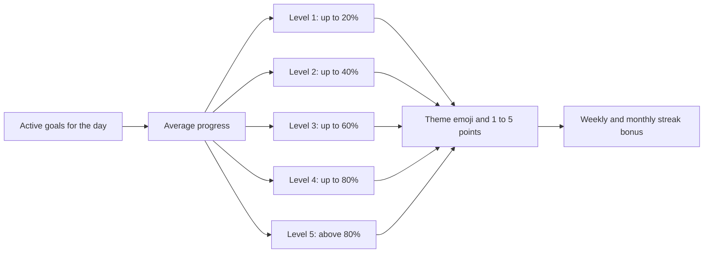

# &nbsp;&nbsp;Gym&nbsp;Nutshell&nbsp;&nbsp;

**[Read in English](#en-gymnutshell)**

_Rastreie metas de nutrição, sono, suplementos e libere conquistas._

O Nutshell nasceu da minha rotina de academia. Eu precisava lembrar de bater as metas de proteínas, carboidratos, água, sono e outros em um só lugar, mas não achei nenhum app que fizesse tudo isso junto.

Durante o dia, você rastreia cada meta com um slider simples, incluindo as metas padrões e outras metas personalizáveis, e recebe notificações ao longo do dia.

Para deixar o app um pouco mais divertido, cada dia completo vira uma conquista temática, com sequências e um calendário do seu progresso.

Tem as mesmas funções da [versão iOS](https://github.com/jonathaxs/gymnutshell-ios) e é gratuito, sem anúncios, sem assinatura e sem cadastro.

**Disponível em [APK](https://jonathasmotta.com/downloads/GymNutshell-2.0.apk)** para Android, com suporte para tablets e Wear OS.

## Funcionalidades - Versão 2.0

**Hoje**
- Data com a frase do dia, que mostra como o seu dia tende a ser (ver "Frase do dia com machine learning").
- Anel de progresso em cinco cores, com o emoji da conquista do dia no centro.
- Metas agrupadas em Essencial, Nutrição, Treino e Suplemento, em lista ou em grade com balões por categoria.
- Controle por slider ou por botões − e +, à escolha do usuário.
- Botão de dia de descanso no Treino e seletor Pendente | Feito nas metas de check-in, como os suplementos.
- Balões que explicam o anel, a conquista e a data com um toque.

**Boas-vindas**
- Configuração inicial em poucas etapas: objetivo e sexo, metas, controles, tema e permissões.
- Metas sugeridas já ajustáveis com − e + antes de começar.

**Metas**
- Metas prontas: musculação, cardio, sono, água, calorias, proteína, carboidrato, gordura boa, fibra e creatina.
- Valores sugeridos pelo objetivo (emagrecimento, se manter ou ganhar massa) e pelo sexo.
- Ao trocar de objetivo, recálculo opcional e proporcional às metas atuais.
- Metas e categorias personalizadas, com ícone próprio e tipo: padrão, com dia de descanso ou de check-in.
- Água em mililitros ou em onças fluidas, americanas ou britânicas.

**Conquistas e temas**
- Cinco níveis por dia, um para cada cor do anel (faixas de 20%).
- 19 temas em seis categorias (esporte, animais, elementos e natureza, progresso, herói e cosmos), cada um com seus emojis e nomes de nível, incluindo variações no feminino.
- Pontos por dia de 1 a 5, conforme o nível.
- Bônus de sequência semanais e mensais para quem mantém os níveis 4 e 5 todos os dias.
- Calendário mensal e histórico editável dos últimos 30 dias.
- Gráfico com a média de cada dia da semana.

**Registros**
- Dias registrados, pontos e bônus acumulados.
- Quantidade de dias em cada nível, atividade recente e últimos 7 dias.

**Frase do dia com machine learning**
- Um modelo de regressão logística, escrito em Kotlin e treinado no próprio aparelho, estima a chance de o dia ser fraco (60% ou menos das metas).
- Usa só o histórico do usuário: dia da semana, ontem, os últimos 7 dias, a sequência, o sono e o treino.
- A previsão só aparece quando acerta mais do que regras simples, como a média do dia da semana. Se não acertar, o app mostra essa média.
- Começa depois de 21 dias de registro. O balão da data mostra o que mais pesou no dia.
- Nada sai do aparelho: sem servidor e sem TensorFlow Lite.

**Wear OS**
- App próprio em três páginas: progresso do dia, estatísticas e notificações.
- Sincronização nos dois sentidos com o celular.
- Tile com o progresso do dia.

**Widgets**
- Progresso, Calendário e Metas, com o anel de cinco cores e fundo configurável.

**Health Connect**
- Leitura dos treinos para marcar musculação e cardio automaticamente.
- Registro das horas de sono.
- Permissões pedidas na configuração inicial ou depois, só para o que o usuário ativar.

**Lembretes**
- Notificações locais por meta, com intervalo configurável e horário limitado ao período do dia.
- Suplementos com horários fixos e o botão "Tomei" na própria notificação.
- Opção de agrupar os avisos no mesmo horário e de mostrar emojis nas notificações.
- Histórico das notificações recebidas.

**Dados e personalização**
- Backup em JSON para exportar e importar, compatível com a versão iOS e com backups da 1.0.
- Backup automático do sistema Android.
- Cor de destaque e aparência clara, escura ou a do aparelho.
- Interface em 11 idiomas, com troca dentro do app: português do Brasil, inglês (EUA e Reino Unido), espanhol, francês, alemão, italiano, japonês, coreano, chinês simplificado e turco.
- Suporte a TalkBack.
- Layout adaptado a telas largas, como tablets e dobráveis.

## Arquitetura



- **Kotlin** e **Jetpack Compose** com **Material 3** em toda a interface, no padrão **MVVM**: cada tela tem sua ViewModel, e o estado flui por `StateFlow`.
- Navegação com **Navigation Compose**: a tela Hoje é a raiz e Registros, Conquistas e Ajustes abrem como páginas.
- **Três módulos Gradle**:
  - `:core` tem domínio e persistência, sem interface;
  - `:app` é o app do celular, com os widgets;
  - `:wear` é o app do relógio.
- Toda regra que pode ser testada sem interface fica no `:core`. Assim o relógio e os widgets reaproveitam a mesma lógica.
- **Room** para os registros diários e as metas personalizadas; **DataStore** para as preferências. As chaves são as mesmas do iOS, o que mantém o backup compatível entre as plataformas.
- **kotlinx.serialization** para o backup e a sincronização com o relógio.
- **WorkManager** para os lembretes, **Glance** para os widgets, **Health Connect** para a integração com a saúde e **Wear Data Layer** para a sincronização com o relógio.
- **Machine learning sem bibliotecas**: regressão logística com gradiente em lote, 15 variáveis só do passado, validação em ordem de data e comparação com duas regras simples. É o mesmo algoritmo do iOS, conferido com os mesmos vetores de teste.
- Anel de cinco cores e gráfico por dia da semana desenhados em Compose, sem bibliotecas de gráficos.
- Testes unitários com JUnit, concentrados no `:core`, e testes instrumentados de acessibilidade com o Compose.

### Do check-in à conquista



## Estrutura do repositório

```text
GymNutshell/
├── core/                      Domínio e persistência, sem interface
│   └── src/main/java/.../core/
│       ├── domain/            Metas, cálculo das metas, conquistas, temas e bônus
│       ├── ml/                Frase do dia: variáveis, regressão logística e média por dia da semana
│       ├── data/              Banco Room, DAOs e repositórios sobre DataStore
│       ├── backup/            Formato e leitura do backup JSON
│       ├── sync/              Snapshot enviado ao relógio
│       ├── theme/             Cores de destaque
│       └── widget/            Snapshot e fundo dos widgets
├── app/                       App do celular
│   └── src/main/java/.../
│       ├── ui/                Telas por área: Hoje, Registros, Conquistas, Ajustes e boas-vindas
│       ├── widget/            Widgets Glance
│       ├── notifications/     Lembretes com WorkManager
│       ├── health/            Integração com o Health Connect
│       └── wear/              Sincronização com o relógio
├── wear/                      App Wear OS, com Tile
└── gradle/libs.versions.toml  Versões centralizadas das dependências
```

## Requisitos

- Android 10 (API 29) ou superior no celular.
- Wear OS 3 (API 30) ou superior no relógio.
- Android Studio com o Android Gradle Plugin 9.5 e o Kotlin 2.4.

Para compilar pelo terminal, use o JDK que vem com o Android Studio:

```bash
cd GymNutshell
export JAVA_HOME="/Applications/Android Studio.app/Contents/jbr/Contents/Home"
./gradlew :app:assembleDebug
./gradlew :core:testDebugUnitTest
```

## Instalação

Por enquanto o app não está na Google Play. A versão 2.0 é distribuída como APK assinado, para instalação direta no aparelho: [baixar o GymNutshell-2.0.apk](https://jonathasmotta.com/downloads/GymNutshell-2.0.apk). Quem já tem a 1.0 pode instalar por cima, sem perder os dados.

## Privacidade

O Gym Nutshell não exige cadastro e não coleta dados. As informações ficam no próprio aparelho e no backup do sistema Android do usuário. Os dados de saúde ficam no Health Connect e só são lidos ou gravados com a permissão do usuário. A frase do dia é calculada no próprio aparelho. Não há servidores próprios, ferramentas de análise ou anúncios.

## Autor

Desenvolvido por **Jonathas Motta** ([@jonathaxs](https://github.com/jonathaxs)).

---

# &nbsp;&nbsp;(EN) Gym&nbsp;Nutshell&nbsp;&nbsp;

**[Leia em português](#gymnutshell)**

_Track nutrition, sleep and supplement goals and unlock achievements._

Nutshell grew out of my gym routine. I needed to remember to hit my protein, carbs, water, sleep and other goals in one place, but I couldn't find an app that did all of that together.

During the day, you track each goal with a simple slider, including the default goals and your own custom ones, and get notifications throughout the day.

To make the app a bit more fun, every completed day becomes a themed achievement, with streaks and a calendar of your progress.

It has the same features as the [iOS version](https://github.com/jonathaxs/gymnutshell-ios) and is free, with no ads, no subscription and no sign-up.

**Available as an [APK](https://jonathasmotta.com/downloads/GymNutshell-2.0.apk)** for Android, with support for tablets and Wear OS.

## Features - Version 2.0

**Today**
- The date with the daily insight, a line that shows how your day is likely to go (see "Daily insight with machine learning").
- A five-color progress ring, with the day's achievement emoji in the center.
- Goals grouped into Essential, Nutrition, Training and Supplement, as a list or as a grid with a popover per category.
- Slider or − and + buttons, whichever the user prefers.
- Rest day button for Training and a Pending | Done picker for check-in goals, such as supplements.
- Popovers that explain the ring, the achievement and the date with a tap.

**Welcome**
- A short first-run setup: goal and sex, goals, controls, theme and permissions.
- Suggested goals you can adjust with − and + before you start.

**Goals**
- Ready-made goals: weight training, cardio, sleep, water, calories, protein, carbs, healthy fats, fiber and creatine.
- Suggested values based on the goal (cutting, maintenance or bulking) and on sex.
- When the goal changes, an optional recalculation proportional to the current goals.
- Custom goals and categories, with their own icon and type: standard, with rest day or check-in.
- Water in milliliters or in US or UK fluid ounces.

**Achievements and themes**
- Five levels per day, one for each ring color (20% bands).
- 19 themes in six categories (sport, animals, elements and nature, progress, hero and cosmos), each with its own emojis and level names, including feminine versions.
- 1 to 5 points per day, based on the level.
- Weekly and monthly streak bonuses for keeping levels 4 and 5 every day.
- Monthly calendar and editable history for the last 30 days.
- Chart with the average for each weekday.

**Records**
- Logged days, points and bonuses earned.
- Number of days at each level, recent activity and the last 7 days.

**Daily insight with machine learning**
- A logistic regression model, written in Kotlin and trained on the device, estimates the chance of a weak day (60% of the goals or less).
- It only uses the user's own history: the weekday, yesterday, the last 7 days, the streak, sleep and workouts.
- The forecast only shows up when it beats simple rules, such as the weekday average. Otherwise, the app shows that average.
- It starts after 21 logged days. The date popover shows what weighed most that day.
- Nothing leaves the device: no server and no TensorFlow Lite.

**Wear OS**
- Its own app with three pages: the day's progress, stats and notifications.
- Two-way sync with the phone.
- Tile with the day's progress.

**Widgets**
- Progress, Calendar and Goals, with the five-color ring and a configurable background.

**Health Connect**
- Reads workouts to check off weight training and cardio automatically.
- Saves sleep hours.
- Permissions are requested during setup or later, only for what the user turns on.

**Reminders**
- Local notifications per goal, with a configurable interval and limited to daytime hours.
- Supplements at fixed times, with a "Taken" button right in the notification.
- Options to group reminders at the same time and to show emojis in notifications.
- History of received notifications.

**Data and personalization**
- JSON backup to export and import, compatible with the iOS version and with 1.0 backups.
- Automatic Android system backup.
- Accent color and light, dark or device appearance.
- Interface in 11 languages, with a switch inside the app: Brazilian Portuguese, English (US and UK), Spanish, French, German, Italian, Japanese, Korean, Simplified Chinese and Turkish.
- TalkBack support.
- Layout adapted to wide screens, such as tablets and foldables.

## Architecture



- **Kotlin** and **Jetpack Compose** with **Material 3** throughout the interface, using the **MVVM** pattern: each screen has its own ViewModel, and state flows through `StateFlow`.
- Navigation with **Navigation Compose**: Today is the root, and Records, Achievements and Settings open as pages.
- **Three Gradle modules**:
  - `:core` holds the domain and persistence, with no UI;
  - `:app` is the phone app, with the widgets;
  - `:wear` is the watch app.
- Every rule that can be tested without UI lives in `:core`. That way the watch and the widgets reuse the same logic.
- **Room** for daily records and custom goals; **DataStore** for preferences. The keys are the same as on iOS, which keeps the backup compatible across platforms.
- **kotlinx.serialization** for the backup and the watch sync.
- **WorkManager** for reminders, **Glance** for widgets, **Health Connect** for health integration and **Wear Data Layer** for syncing with the watch.
- **Machine learning with no libraries**: logistic regression with batch gradient descent, 15 past-only features, date-ordered validation and a comparison against two simple rules. It is the same algorithm as on iOS, checked against the same test vectors.
- Five-color ring and weekday chart drawn in Compose, with no chart libraries.
- Unit tests with JUnit, focused on `:core`, and instrumented accessibility tests with Compose.

### From check-in to achievement



## Repository structure

```text
GymNutshell/
├── core/                      Domain and persistence, with no UI
│   └── src/main/java/.../core/
│       ├── domain/            Goals, goal calculation, achievements, themes and bonuses
│       ├── ml/                Daily insight: features, logistic regression and weekday average
│       ├── data/              Room database, DAOs and repositories over DataStore
│       ├── backup/            JSON backup format and parsing
│       ├── sync/              Snapshot sent to the watch
│       ├── theme/             Accent colors
│       └── widget/            Widget snapshot and background
├── app/                       Phone app
│   └── src/main/java/.../
│       ├── ui/                Screens by area: Today, Records, Achievements, Settings and welcome
│       ├── widget/            Glance widgets
│       ├── notifications/     Reminders with WorkManager
│       ├── health/            Health Connect integration
│       └── wear/              Watch sync
├── wear/                      Wear OS app, with Tile
└── gradle/libs.versions.toml  Centralized dependency versions
```

## Requirements

- Android 10 (API 29) or later on the phone.
- Wear OS 3 (API 30) or later on the watch.
- Android Studio with Android Gradle Plugin 9.5 and Kotlin 2.4.

To build from the terminal, use the JDK that comes with Android Studio:

```bash
cd GymNutshell
export JAVA_HOME="/Applications/Android Studio.app/Contents/jbr/Contents/Home"
./gradlew :app:assembleDebug
./gradlew :core:testDebugUnitTest
```

## Installation

The app is not on Google Play yet. Version 2.0 is distributed as a signed APK, to install directly on the device: [download GymNutshell-2.0.apk](https://jonathasmotta.com/downloads/GymNutshell-2.0.apk). If you already have 1.0, you can install it over it without losing your data.

## Privacy

Gym Nutshell requires no sign-up and collects no data. Information stays on the device and in the user's Android system backup. Health data stays in Health Connect and is only read or written with the user's permission. The daily insight is calculated on the device itself. There are no servers of its own, no analytics and no ads.

## Author

Developed by **Jonathas Motta** ([@jonathaxs](https://github.com/jonathaxs)).
