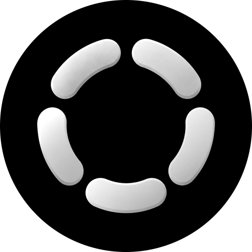
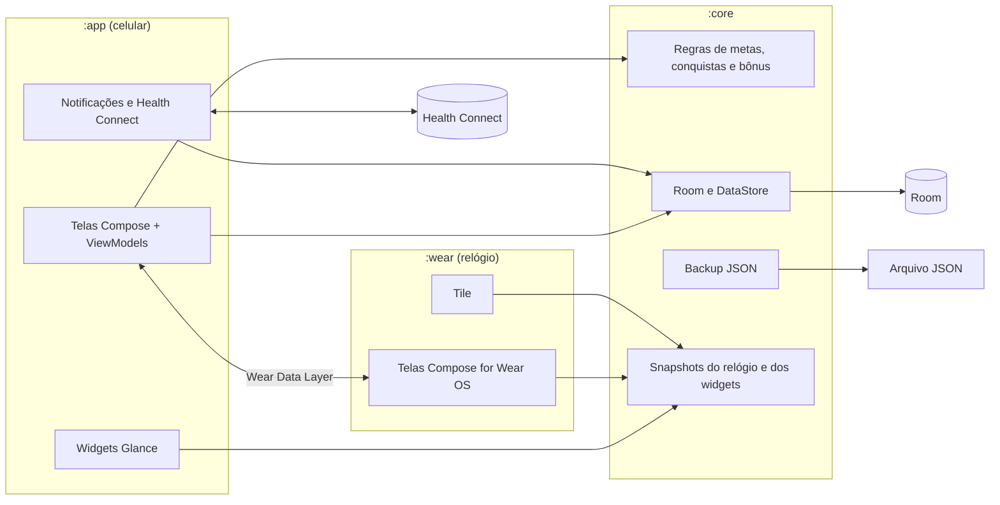
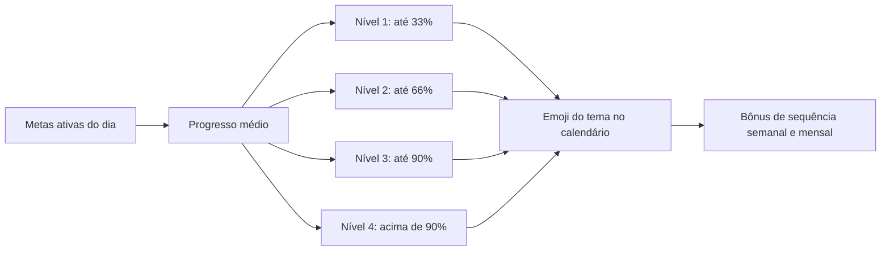
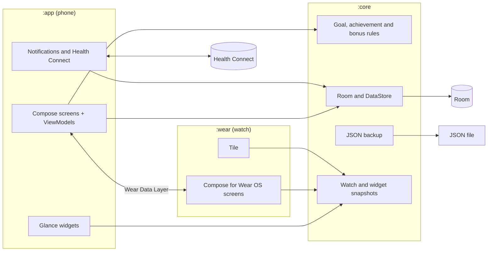
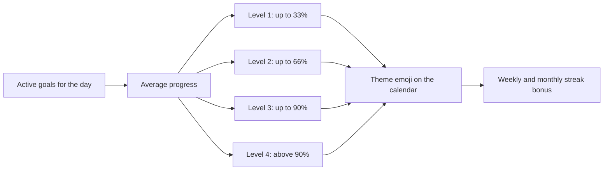

# &nbsp;&nbsp;Gym&nbsp;Nutshell&nbsp;&nbsp;

**[Read in English](#en-gymnutshell)**

_Rastreie metas de nutrição, sono, suplementos e libere conquistas._

O Nutshell nasceu da minha rotina de academia. Eu precisava lembrar de bater as metas de proteínas, carboidratos, água, sono e outros em um só lugar, mas não achei nenhum app que fizesse tudo isso junto.

Durante o dia, você rastreia cada meta com um slider simples, incluindo as metas padrões e outras metas personalizáveis, e recebe notificações ao longo do dia.

Para deixar o app um pouco mais divertido, cada dia completo vira uma conquista temática, com sequências e um calendário do seu progresso.

Tem as mesmas funções da [versão iOS](https://github.com/jonathaxs/gymnutshell-ios) e é gratuito, sem anúncios, sem assinatura e sem cadastro.

**Disponível em [APK](https://jonathasmotta.com/downloads/GymNutshell-1.0.apk)** para Android, com suporte para tablets e Wear OS.

## Funcionalidades - Versão 1.0 
_(Algumas funcionalidades estão sendo removidas e outras aprimoradas na futura Versão 2.0. Qualquer dúvida ou sugestão entre em [contato comigo](https://jonathasmotta.com))_ 

**Hoje**
- Metas do dia com registro rápido e anel de progresso geral.
- Botão de dia de descanso, que conta a meta como cumprida nos dias de pausa.
- Metas nas categorias Essencial, Nutrição, Treino e Suplemento, com ordem personalizável.

**Metas**
- Metas prontas: musculação, cardio, sono, água, calorias, proteína, carboidrato, gordura boa, fibra e creatina.
- Valores recomendados calculados a partir do peso, altura, idade, sexo e objetivo, com calorias pela fórmula de Mifflin-St Jeor.
- Metas e categorias personalizadas criadas pelo usuário.
- Unidades no sistema métrico ou imperial.

**Conquistas e temas**
- Quatro níveis de conquista por dia, conforme o progresso médio das metas.
- 19 temas em seis categorias (esporte, animais, lutadores, elementos, espaço e competição), cada um com seus emojis e nomes de nível, incluindo variações no feminino.
- Calendário mensal de conquistas, com histórico editável.
- Bônus de sequência semanais e mensais para quem mantém os níveis mais altos todos os dias.

**Progresso**
- Dias registrados, pontos e bônus acumulados.
- Quantidade de dias em cada nível e resumo das metas e dos dados físicos.

**Wear OS**
- App próprio em três páginas: progresso do dia, estatísticas e notificações.
- Sincronização nos dois sentidos com o celular.
- Tile com o progresso do dia.

**Widgets**
- Progresso, Calendário e Metas, com fundo configurável.

**Health Connect**
- Leitura dos treinos para marcar musculação e cardio automaticamente.
- Registro das horas de sono.
- Permissões pedidas sob demanda, só para o que o usuário ativar.

**Lembretes**
- Notificações locais por meta, com intervalo configurável e horário limitado ao período do dia.
- Histórico das notificações recebidas.

**Dados e personalização**
- Backup em JSON para exportar e importar, compatível com a versão iOS.
- Backup automático do sistema Android.
- Cores de destaque configuráveis e bloqueio de orientação da tela.
- Interface em Português do Brasil e English, com troca de idioma dentro do app.
- Suporte a TalkBack, modo claro e modo escuro.
- Layout adaptado a telas largas, com navegação lateral em tablets e celulares na horizontal.

## Arquitetura



- **Kotlin** e **Jetpack Compose** com **Material 3** em toda a interface, no padrão **MVVM**: cada tela tem sua ViewModel, e o estado flui por `StateFlow`.
- **Três módulos Gradle**:
  - `:core` tem domínio e persistência, sem interface;
  - `:app` é o app do celular, com os widgets;
  - `:wear` é o app do relógio.
- Toda regra que pode ser testada sem interface fica no `:core`. Assim o relógio e os widgets reaproveitam a mesma lógica.
- **Room** para os registros diários e as metas personalizadas; **DataStore** para as preferências. As chaves são as mesmas do iOS, o que mantém o backup compatível entre as plataformas.
- **kotlinx.serialization** para o backup e a sincronização com o relógio.
- **WorkManager** para os lembretes, **Glance** para os widgets, **Health Connect** para a integração com a saúde e **Wear Data Layer** para a sincronização com o relógio.
- Testes unitários com JUnit, concentrados no `:core`, e testes instrumentados de acessibilidade com o Compose.

### Do check-in à conquista



## Estrutura do repositório

```text
GymNutshell/
├── core/                      Domínio e persistência, sem interface
│   └── src/main/java/.../core/
│       ├── domain/            Metas, cálculo das metas, conquistas, temas e bônus
│       ├── data/              Banco Room, DAOs e repositórios sobre DataStore
│       ├── backup/            Formato e leitura do backup JSON
│       ├── sync/              Snapshot enviado ao relógio
│       ├── theme/             Cores de destaque
│       └── widget/            Snapshot e fundo dos widgets
├── app/                       App do celular
│   └── src/main/java/.../
│       ├── ui/                Telas por área: Hoje, Conquistas, Progresso, Ajustes e boas-vindas
│       ├── widget/            Widgets Glance
│       ├── notifications/     Lembretes com WorkManager
│       ├── health/            Integração com o Health Connect
│       └── wear/              Sincronização com o relógio
├── wear/                      App Wear OS, com Tile
└── gradle/libs.versions.toml  Versões centralizadas das dependências
```

## Requisitos

- Android 10 (API 29) ou superior no celular.
- Wear OS 3 (API 30) ou superior no relógio.
- Android Studio com o Android Gradle Plugin 9 e o Kotlin 2.2.

Para compilar pelo terminal, use o JDK que vem com o Android Studio:

```bash
cd GymNutshell
export JAVA_HOME="/Applications/Android Studio.app/Contents/jbr/Contents/Home"
./gradlew :app:assembleDebug
./gradlew :core:testDebugUnitTest
```

## Instalação

Por enquanto o app não está na Google Play. A versão 1.0 é distribuída como APK assinado, para instalação direta no aparelho: [baixar o GymNutshell-1.0.apk](https://jonathasmotta.com/downloads/GymNutshell-1.0.apk).

## Privacidade

O Gym Nutshell não exige cadastro e não coleta dados. As informações ficam no próprio aparelho e no backup do sistema Android do usuário. Os dados de saúde ficam no Health Connect e só são lidos ou gravados com a permissão do usuário. Não há servidores próprios, ferramentas de análise ou anúncios.

## Autor

Desenvolvido por **Jonathas Motta** ([@jonathaxs](https://github.com/jonathaxs)).

---

# &nbsp;&nbsp;(EN) Gym&nbsp;Nutshell&nbsp;&nbsp;

**[Leia em português](#gymnutshell)**

_Track nutrition, sleep and supplement goals and unlock achievements._

Nutshell grew out of my gym routine. I needed to remember to hit my protein, carbs, water, sleep and other goals in one place, but I couldn't find an app that did all of that together.

During the day, you track each goal with a simple slider, including the default goals and your own custom ones, and get notifications throughout the day.

To make the app a bit more fun, every completed day becomes a themed achievement, with streaks and a calendar of your progress.

It has the same features as the [iOS version](https://github.com/jonathaxs/gymnutshell-ios) and is free, with no ads, no subscription and no sign-up.

**Available as an [APK](https://jonathasmotta.com/downloads/GymNutshell-1.0.apk)** for Android, with support for tablets and Wear OS.

## Features - Version 1.0
_(Some features are being removed and others improved in the upcoming Version 2.0. For questions or suggestions, [get in touch](https://jonathasmotta.com).)_

**Today**
- The day's goals with quick logging and an overall progress ring.
- Rest day button, which counts the goal as done on days off.
- Goals in the Essential, Nutrition, Training and Supplement categories, in an order you choose.

**Goals**
- Ready-made goals: weight training, cardio, sleep, water, calories, protein, carbs, healthy fats, fiber and creatine.
- Recommended values calculated from weight, height, age, sex and goal, with calories from the Mifflin-St Jeor equation.
- Custom goals and categories created by the user.
- Metric or imperial units.

**Achievements and themes**
- Four achievement levels per day, based on the average progress of the goals.
- 19 themes in six categories (sports, animals, fighters, elements, space and competition), each with its own emojis and level names, including feminine versions.
- Monthly achievement calendar, with editable history.
- Weekly and monthly streak bonuses for keeping the highest levels every day.

**Progress**
- Logged days, points and bonuses earned.
- Number of days at each level and a summary of goals and body data.

**Wear OS**
- Its own app with three pages: the day's progress, stats and notifications.
- Two-way sync with the phone.
- Tile with the day's progress.

**Widgets**
- Progress, Calendar and Goals, with a configurable background.

**Health Connect**
- Reads workouts to check off weight training and cardio automatically.
- Saves sleep hours.
- Permissions are requested on demand, only for what the user turns on.

**Reminders**
- Local notifications per goal, with a configurable interval and limited to daytime hours.
- History of received notifications.

**Data and personalization**
- JSON backup to export and import, compatible with the iOS version.
- Automatic Android system backup.
- Configurable accent colors and screen orientation lock.
- Interface in Brazilian Portuguese and English, with a language switch inside the app.
- Support for TalkBack, light mode and dark mode.
- Layout adapted to wide screens, with side navigation on tablets and on phones in landscape.

## Architecture



- **Kotlin** and **Jetpack Compose** with **Material 3** throughout the interface, using the **MVVM** pattern: each screen has its own ViewModel, and state flows through `StateFlow`.
- **Three Gradle modules**:
  - `:core` holds the domain and persistence, with no UI;
  - `:app` is the phone app, with the widgets;
  - `:wear` is the watch app.
- Every rule that can be tested without UI lives in `:core`. That way the watch and the widgets reuse the same logic.
- **Room** for daily records and custom goals; **DataStore** for preferences. The keys are the same as on iOS, which keeps the backup compatible across platforms.
- **kotlinx.serialization** for the backup and the watch sync.
- **WorkManager** for reminders, **Glance** for widgets, **Health Connect** for health integration and **Wear Data Layer** for syncing with the watch.
- Unit tests with JUnit, focused on `:core`, and instrumented accessibility tests with Compose.

### From check-in to achievement



## Repository structure

```text
GymNutshell/
├── core/                      Domain and persistence, with no UI
│   └── src/main/java/.../core/
│       ├── domain/            Goals, goal calculation, achievements, themes and bonuses
│       ├── data/              Room database, DAOs and repositories over DataStore
│       ├── backup/            JSON backup format and parsing
│       ├── sync/              Snapshot sent to the watch
│       ├── theme/             Accent colors
│       └── widget/            Widget snapshot and background
├── app/                       Phone app
│   └── src/main/java/.../
│       ├── ui/                Screens by area: Today, Achievements, Progress, Settings and welcome
│       ├── widget/            Glance widgets
│       ├── notifications/     Reminders with WorkManager
│       ├── health/            Health Connect integration
│       └── wear/              Watch sync
├── wear/                      Wear OS app, with Tile
└── gradle/libs.versions.toml  Centralized dependency versions
```

## Requirements

- Android 10 (API 29) or later on the phone.
- Wear OS 3 (API 30) or later on the watch.
- Android Studio with Android Gradle Plugin 9 and Kotlin 2.2.

To build from the terminal, use the JDK that comes with Android Studio:

```bash
cd GymNutshell
export JAVA_HOME="/Applications/Android Studio.app/Contents/jbr/Contents/Home"
./gradlew :app:assembleDebug
./gradlew :core:testDebugUnitTest
```

## Installation

The app is not on Google Play yet. Version 1.0 is distributed as a signed APK, to install directly on the device: [download GymNutshell-1.0.apk](https://jonathasmotta.com/downloads/GymNutshell-1.0.apk).

## Privacy

Gym Nutshell requires no sign-up and collects no data. Information stays on the device and in the user's Android system backup. Health data stays in Health Connect and is only read or written with the user's permission. There are no servers of its own, no analytics and no ads.

## Author

Developed by **Jonathas Motta** ([@jonathaxs](https://github.com/jonathaxs)).
